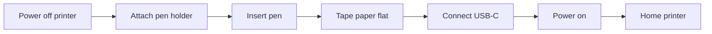
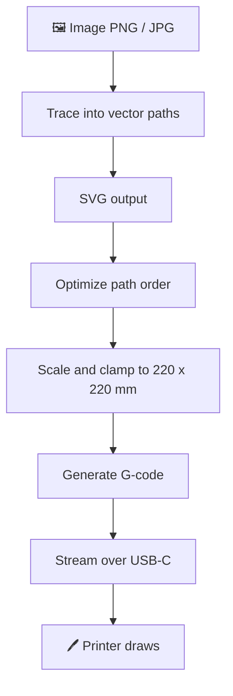

<div align="center">


<br>


### Plug in with USB-C. Load an image. Watch your printer draw it.

[**Download**](../../releases) · [**Quick Start**](#-quick-start) · [**Pen Holder**](#-pen-holder) · [**Troubleshooting**](#-troubleshooting) · [**Roadmap**](#-roadmap)

</div>

<br>

---

## ✨ What is this?

A 3D printer is already a precise motion machine. Swap the hot end for a pen holder and it becomes a **pen plotter**.

**Creality Plotter Software** is the missing piece. It is a desktop app that talks to your printer over USB, turns images into plottable SVG paths, converts them to G-code, and streams them to the printer while you watch a live preview.

Built around the **Creality Ender 3 V3 SE**, whose **USB-C port** lets a computer talk to it directly.

> [!NOTE]
> This project is in **early development**. The [Roadmap](#-roadmap) shows what works today and what is coming.

<br>

## 🚀 Features

| | Feature | Details |
|:-:|---|---|
| 🔌 | **USB-C connection** | Direct serial link to the Ender 3 V3 SE on macOS and Windows |
| 🔍 | **Auto port detection** | Finds your printer and lets you pick if there are several |
| 🖼️ | **Image to SVG** | Load a PNG or JPG and get clean vector paths that work with **any** plotter |
| 🧭 | **SVG to G-code** | Pen up/down control, speed settings, and bed limits so the toolhead never leaves the bed |
| 👀 | **Live preview** | See exactly what the pen will draw before and during the plot |
| ⏯️ | **Full control** | Start, pause, resume, and stop at any time |
| 📏 | **Pen calibration** | Guided setup for pen-down and pen-up heights |
| ✍️ | **Handwriting scan** | Turn your own handwriting into plottable paths *(Pro)* |
| 🌍 | **Open source** | Built with Electron and Node.js |

<br>

## 💎 Free vs Pro

| Feature | 🆓 Free | ⭐ Pro |
|---|:---:|:---:|
| USB-C connection to Ender 3 V3 SE | ✅ | ✅ |
| Image to SVG | ✅ | ✅ |
| SVG to G-code and plotting | ✅ | ✅ |
| Live preview and controls | ✅ | ✅ |
| Handwriting scan | ❌ | ✅ |
| Handwriting to plottable font | ❌ | ✅ |

The free version is fully usable for plotting. **Pro** supports continued development.

<br>

## 🧰 What you need

| Item | Notes |
|---|---|
| 🖨️ **Creality Ender 3 V3 SE** | The supported printer |
| 🔗 **USB-C data cable** | Some cheap cables only charge and will not work |
| 💻 **Mac or Windows computer** | macOS and Windows supported |
| 🖊️ **Pen** | Fineliner or gel pen works best |
| 🧩 **Printed pen holder** | See [Pen holder](#-pen-holder) |
| 📄 **Paper + tape or clips** | To hold the paper flat on the bed |
| 🟢 **Node.js 18+** | Only if you run from source |

<br>

## 🧩 Pen holder

<div align="center">

### [**Pen Plotter for Ender 3 V3 SE on Printables**](https://www.printables.com/model/681121-pen-plotter-for-ender-3-v3-se)

[⬇️ Go to the files](https://www.printables.com/model/681121-pen-plotter-for-ender-3-v3-se/files)

</div>

Print it, attach it to your toolhead, and follow the author's assembly notes.

> [!TIP]
> - Use a **firm-tipped pen** like a fineliner or gel pen. Soft felt tips wear fast.
> - A little **spring give** in the holder makes lines much more consistent.
> - Keep clips and tape **out of the drawing area** so nothing crashes into the toolhead.

<br>

## 🔧 Hardware setup



1. **Power off** the printer.
2. **Attach the pen holder** to the toolhead using the model's instructions.
3. **Insert the pen** so the tip sits slightly below the lowest point of the toolhead.
4. **Tape or clip** a sheet of paper flat on the bed.
5. **Connect** the USB-C cable from the printer to your computer.
6. **Power on** the printer.
7. **Home** the printer from its own screen so the axes are in a known position.

<br>

## 📦 Install

### Option A: Download a release (easiest)

1. Open the [**Releases**](../../releases) page.
2. Download the file for your system:

| System | File |
|---|---|
| 🪟 Windows | `.exe` installer |
| 🍎 macOS | `.dmg` |

3. Install and open it.

> [!NOTE]
> On macOS, if the app is not code-signed, right-click it and choose **Open** the first time.

### Option B: Run from source

```bash
git clone https://github.com/YOUR-USERNAME/creality-plotter-software.git
cd creality-plotter-software
npm install
npm start
```

<details>
<summary><b>🔌 USB drivers</b></summary>

<br>

- **macOS:** usually works with no extra driver.
- **Windows:** Windows 10 and 11 normally install the driver on their own. If the printer does not show up as a COM port, install the **CH340** serial driver and reconnect.

</details>

<br>

## ⚡ Quick start


1. Open the app.
2. Pick your serial port and click **Connect**. Default baud rate is `115200`.
3. Click **Load Image** and choose a PNG or JPG.
4. Adjust the conversion sliders until the SVG preview looks right.
5. Set the size and position of the drawing on the **220 x 220 mm** bed.
6. Open **Pen Calibration** and set the pen-down and pen-up heights.
7. Click **Preview** to see the exact path the pen will follow.
8. Click **Start Plot**.

You can pause, resume, or stop at any time.

<br>

## 📏 Calibration

> [!IMPORTANT]
> Pen height is the most important setting. Do this before your first plot.

1. **Home** the printer.
2. Open **Pen Calibration** in the app.
3. Lower Z in **0.1 mm** steps until the pen just touches the paper. Save it as **Pen Down Z**.
4. Raise Z until the pen clears the paper by **2 to 3 mm**. Save it as **Pen Up Z**.
5. Click **Draw Test Square** and check that the lines are clean and the square closes.

| Problem | Fix |
|---|---|
| Faint or missing lines | Pen Down Z is too high. Lower it slightly |
| Pen drags or tears paper | Pen Down Z is too low. Raise it |

<br>

## 🧠 How it works



1. **Image to SVG:** the image is traced into vector paths.
2. **Path optimization:** paths are reordered to cut down on pen-up travel.
3. **SVG to G-code:** every path becomes moves, with pen up and pen down as Z moves.
4. **Bed clamping:** coordinates are scaled and limited to the bed area.
5. **Streaming:** G-code is sent line by line, and the app waits for the printer to reply `ok` before sending the next line.

<details>
<summary><b>📄 Example G-code output</b></summary>

<br>

```gcode
G21            ; millimeters
G90            ; absolute positioning
G28            ; home all axes
G0 Z5 F1000    ; pen up
G0 X50 Y50 F6000
G1 Z0 F500     ; pen down
G1 X100 Y50 F2000
G1 X100 Y100
G0 Z5 F1000    ; pen up
```

</details>

> [!WARNING]
> The nozzle and bed heaters stay **off** the whole time. Never leave the printer running unattended.

<br>

## ✍️ Handwriting scan (Pro)


1. Write on plain white paper with a dark pen.
2. Take a clear, flat, well-lit photo or scan.
3. Import it in the **Handwriting** tab.
4. The app cleans the image, finds the strokes, and turns them into single-line paths.
5. Plot it directly or export it as SVG.

Enter your Pro license key in **Settings > License**.

<br>

## ⚙️ Settings reference

| Setting | Default | What it does |
|---|:---:|---|
| Baud rate | `115200` | Serial speed |
| Bed width / height | `220 / 220 mm` | Drawing area limits |
| Pen up Z | `3 mm` | Height while travelling |
| Pen down Z | `0 mm` | Height while drawing (set in calibration) |
| Draw speed | `2000 mm/min` | Speed with the pen down |
| Travel speed | `6000 mm/min` | Speed with the pen up |
| Z speed | `500 mm/min` | Speed of pen up/down moves |
| Path optimization | `On` | Reorders paths to reduce travel |
| Margin | `5 mm` | Keeps drawings away from the bed edges |

<br>

## 🗂️ Project structure

```
creality-plotter-software/
├── src/
│   ├── main/               Electron main process (serial, files)
│   ├── renderer/           UI (preview, controls, settings)
│   └── core/
│       ├── image-to-svg/   Image tracing
│       ├── svg-to-gcode/   Path and G-code generation
│       ├── serial/         Printer connection and streaming
│       └── handwriting/    Handwriting scan (Pro)
├── assets/                 Icons and images
├── docs/                   Extra docs and photos
├── .github/workflows/      Build and release automation
├── package.json
├── README.md
└── LICENSE
```

<br>

## 🛠️ Development

```bash
npm install     # install dependencies
npm start       # run the app in development
npm run lint    # check code style
npm test        # run tests
```

**Main dependencies:** Electron, Node.js, and [serialport](https://serialport.io/).

> [!IMPORTANT]
> Keep secrets like license keys out of the code. Use a `.env` file (see `.env.example`). `.env` is listed in `.gitignore`.

### Building releases

```bash
npm run build:mac    # builds a .dmg
npm run build:win    # builds a Windows installer
```

Pushing a version tag such as `v1.0.0` triggers the GitHub Actions workflow, which builds for macOS and Windows and attaches the files to a GitHub Release.

<br>

## 🩺 Troubleshooting

<details>
<summary><b>🔌 The printer does not appear in the port list</b></summary>

<br>

- Use a **data-capable** USB-C cable.
- Reconnect the cable with the printer powered on.
- On Windows, install the **CH340** driver.
- Close other programs that may be using the port (slicers, terminal apps).

</details>

<details>
<summary><b>🚫 Connected but nothing moves</b></summary>

<br>

- Try baud rate `115200`.
- Home the printer from its own screen first.
- Make sure the printer is not in the middle of a print job.

</details>

<details>
<summary><b>🌫️ Lines are faint or missing</b></summary>

<br>

- Lower Pen Down Z a little and redo calibration.
- Check that the pen is not drying out.

</details>

<details>
<summary><b>📄 The pen tears the paper or drags</b></summary>

<br>

- Raise Pen Down Z.
- Lower the draw speed.
- Make sure the paper is taped flat.

</details>

<details>
<summary><b>📐 The drawing is cut off or shifted</b></summary>

<br>

- Check the bed size and margin settings.
- Make sure the printer was homed before plotting.

</details>

<details>
<summary><b>⏹️ The plot stops halfway</b></summary>

<br>

- Check the USB cable and avoid unplugging it.
- Turn off computer sleep during long plots.

</details>

<br>

## ❓ FAQ

<details>
<summary><b>Does this work with any 3D printer?</b></summary>

<br>

It is designed for the Ender 3 V3 SE. Other printers that accept G-code over serial may work with manual settings.

</details>

<details>
<summary><b>Does it work with other plotters?</b></summary>

<br>

The image to SVG converter outputs standard SVG that other plotter software can use.

</details>

<details>
<summary><b>Do I need the paid subscription?</b></summary>

<br>

No. Plotting is free. Pro adds handwriting scanning.

</details>

<details>
<summary><b>Can I use any pen?</b></summary>

<br>

Most fineliners and gel pens work. Test with a cheap one first.

</details>

<details>
<summary><b>Will this damage my printer?</b></summary>

<br>

Used carefully, no. Always calibrate pen height first and keep the heaters off. See the [disclaimer](#-safety-and-disclaimer).

</details>

<br>

## 🗺️ Roadmap

- [ ] USB-C serial connection (macOS and Windows)
- [ ] Automatic port detection
- [ ] Image to SVG
- [ ] SVG to G-code
- [ ] Live preview
- [ ] Start, pause, resume, stop
- [ ] Pen calibration helper
- [ ] Pro license check
- [ ] Handwriting scan
- [ ] Handwriting to font
- [ ] Profiles for other Creality printers
- [ ] Linux support

<br>

## 🤝 Contributing

Contributions are welcome!

1. **Fork** the repo.
2. Create a branch: `git checkout -b feature/my-feature`
3. **Commit** with a clear message.
4. **Push** and open a pull request.

Bug reports should include your OS, printer model, app version, and steps to reproduce.

<br>

## 📜 License

Released under the **MIT License**. See [LICENSE](LICENSE).

<br>

## ⚠️ Safety and disclaimer

> [!WARNING]
> - Keep the nozzle and bed heaters **off** while plotting.
> - Never leave the printer running unattended.
> - Make sure the pen holder is secure so it cannot fall into the mechanism.
> - This project is not affiliated with or endorsed by Creality. Use at your own risk.

<br>

<div align="center">

**If this project helps you, give it a ⭐ on GitHub!**


</div>
